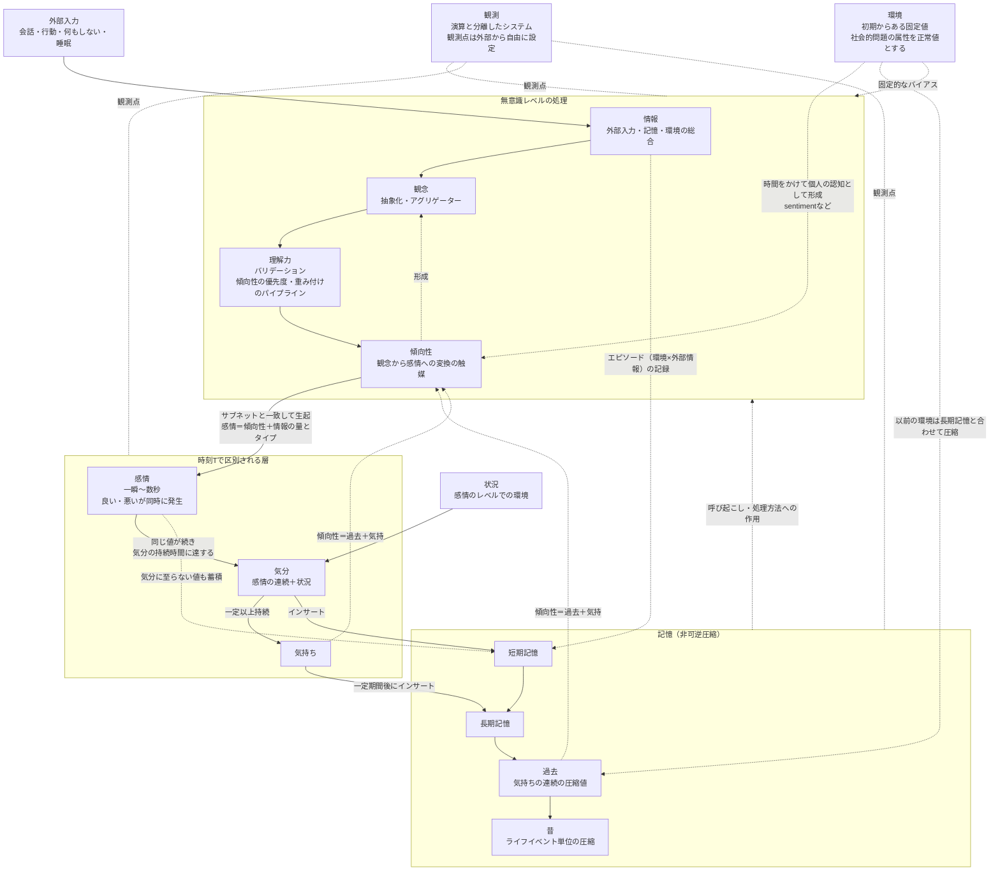

# VPSY 概念整理（仮説の書き分けと構成図）

- 出典の略記：「080」＝感情Prgmのメモ（初期メモ、04/20・06/29・06/30の追記を含む）、「081」＝大学教員によるレビューと、それへの著者の返信、「反論」＝AIによる概念の整理に対する著者の応答
- 本文は、できる限りメモの言葉をそのまま使っている。繋げたり分けたりするために補った言葉や、解釈を入れた箇所は「※補足」と書いている
- 各仮説は「主張」（心や社会のしくみについて言っていること）と「実装方法」（それをどう表すか）に分けている。心理学研究と照合する相手になるのは、主に「主張」の方である
- 初期メモの短文と、後の追記にあるその解説文は、同じ主張として続けて並べている
- VPSYの語（情報、観念、理解力、傾向性、感情、気分、気持ち、記憶、環境、状況、ムードなど）は、システムのモジュール名としてあてがっているもので、一般の意味や専門用語と文字列として一致させてはいない。各語は機能で定義し、先行研究とは文字列ではなく機能（＝意味）で照合する

---

## 0. 研究の問いと一番上の要求

**研究の問い**  

主な問い：一般に感情と呼ばれる現象を時刻Tで分解し多要素と接続したモデルは、心理学研究の結果と過程をどこまで模倣できるか  

副次的な問い：  

- そのモデルにおいて、性格は有限のパターンに収束するか
- 睡眠のように先行研究で決着していない処理を、先行研究の結果と軋轢を生まない範囲で、どこまでセンチネル値のような簡略的な処理で扱えるか

研究の問いは一般語で書き、VPSYのモジュール名（傾向性など）は本文の定義で導入する。  

**一番上の要求**  

心理学研究の結果と、研究が示す心理の過程に対して、VPSYの結果と各層の途中の値を照合でき、その一致と差異を示せる、感情のシミュレーション装置であること。  

---

## 0-2. 照合の前提

VPSYの記述を読み、先行研究と照合するときの前提。AIと議論するときも、この文書とともにこの前提を渡す。  

- VPSYの語は、システムのモジュール名としてあてがっているもので、一般論や専門用語と文字列として一致していないことは前提である。  
先行研究とは、文字列ではなく機能（＝意味）が一致しているかで照合する
- 感情・気分・気持ちは、一般に感情と呼ばれる現象（数分〜1日以上続くものを含む）を、システムでシミュレートするために時刻Tで分解したモジュールである。  
心理学で感情（emotion）と呼ばれ、数分以上続くとされているものは、機能としてはVPSYの気持ちに当たる  
- VPSYは、既存の技術（TCP/IP、HTTP/JSON、バリデーションチェック、ハフマン符号化、TTL、サブネット、Docker、Zabbixなど）を、そのまま使うのではなく、論理の構成や分け方を借りてVPSY向けに広げている。  
技術そのものの性質を理由に、VPSYの主張と矛盾すると判定しない。  
評価の対象は、その技術を借りて表そうとしている心の仕組みの主張である  
- 記憶の非可逆性は、頻度でビット列の長さを決めること（ハフマン符号化の考え方）と、容量（カラムの最大長）に収まらない部分を消すことの組み合わせで生じる。  
節約率の逆数は、それまで続いていたビット列に掛けて長くする値として使う  
- 感情の生起と持続はサブネットとの一致（範囲としての一致）で判定する。  
「同じ値」は範囲としての一致を指す
- 初期メモの短い文と、後から書いた解説文は、同じ主張の短い形と詳しい形の関係で、矛盾ではない
- メモが二つの場合を「〜か〜」でまとめて書いているときは、一対一に結び付けない
- 情報は、外部入力と記憶、環境の総合を指す
- 環境の正常値は「値を持つ」という意味。  
〜経験が無いデフォルトは平常値を持たない属性で、社会的問題の属性やマイノリティ属性を持つことが値になる
- 「すべての社会的問題の属性を同時に持つ人は実在できない」は、同じ時点・同じ役割では被害者と加害者を兼ねられないという時点と役割の制約である
- 主張が言っていないことを、言っているように補って評価しない。  
不明な点は「主張は〜について述べていない」とする

---

## 0-3. モジュールの機能

| モジュール | 受け取るもの | 出すもの・働き | 時間 | 作用先 |
| --- | --- | --- | --- | --- |
| 情報 | 外部入力（思考のデータタイプを含む）、記憶、環境 | それらの総合データ | 時刻tごと | 観念 |
| 観念 | 情報 | 抽象化し、一つにまとめた構造データ（理解力へのデータ契約） | 無意識。時間管理外 | 理解力 |
| 理解力 | 観念の構造データ | バリデーション後のデータ。傾向性の優先度・重み付け | 無意識 | 傾向性 |
| 傾向性 | 理解力の出力。過去と気持ちで変化する | 感情の生起（サブネットとの一致） | 無意識。時間管理外から時間管理への変換 | 感情 |
| 感情 | 傾向性の出力、情報の量とタイプ | 値。再生起すれば持続した感情になる | 一瞬〜長くとも数秒 | 気分、記憶 |
| 気分 | 感情の連続、状況 | 持続した値。TTLで持続し、固まるとぶれにくい | 感情より長い | 気持ち、短期記憶 |
| 気持ち | 気分の持続 | 持続した値 | 気分より長い。一般に感情と呼ばれ数分以上続くものに当たる | 長期記憶、傾向性 |
| 記憶 | エピソードと、そのとき傾向性がどう出力したか（感情・気分・気持ち）、環境×外部情報 | その記録。短期記憶→長期記憶→過去→昔と圧縮される | 日付単位以上で表現が変わる | 情報、観念、理解力、傾向性 |
| 環境 | 初期からあるもの、時間によって形成されるもの。sentimentもまずここに入る | 処理全体へのバイアス。時間をかけて傾向性→観念のように個人の認知として形成されていく | 永続的。克服しない限り固定値 | 観念、理解力、傾向性 |
| 状況 | その場の文脈 | 気分の構成要素、ヘッダ | 感情のレベル | 気分 |
| 性格 | 一定の観測期間の傾向性の出力 | その出力パターンの言語化 | 任意の区間 | ― |
| パーソナリティ | 性格 | 時間経過として常に残り続けていると評価できる性格 | 長期 | ― |
| ムード | ― | データタイプの分類名。値ではなく分類であり、ムードにあたる語がいくつもある | ― | ― |

---

## 1. 前提（立場）

仮説ではなく、VPSYが取る立場として置くもの。  

- **P1 模倣の立場**：
  - 感情というのはシステムでは完全に表現できないという立場を取る。
  - だがしかし模倣としては作り上げることができる。
  - つまりは似ているものを観察することを目的とした活動という立場を取る。（080）
- **P2 模倣の定義**：  
  - 模倣とは、本質としては同じ対象を志向している存在の一つの形態であり、かつ見かけや姿は異なるものを志向できるもの。  
  - 再現でも真似でもない。  
  - 本質的に異なるのに見かけや姿を同じように志向するのは猿真似である。  
  - 感情自体に根源的な一意な説明は不可能であるため、再現や猿真似は否定する。（081）  
- **P3 道具としての位置付け**：
  - 人間としての矜持を保ち、AIや道具といった無機物とも区別される、半有機的ながらもモノとして扱う。
  - 人間が他の人間のために扱うことを前提としたシステムである。（080）
- **P4 目的**：
  - 誰かを理解するためではなく、誰かを理解する一助となること。
  - 人が判断する材料の内の一欠片となること。
  - ゆえに意思決定支援システムとは異なる。（081）

---

## 2. 仮説

### 2-1. 時間による区別

**H01 感情・気分・気持ちは持続時間で区別される**  

- 主張：
  - 感情は気分と比べて持続時間的に短命であり、気分は気持ちと比べて持続時間的に短命である。
  - 感情は時間によって変わるものであり、感情、気分、気持ちとなって遷移していく。（080 初期メモ、04/20）
- 主張：
  - 感情・気分・気持ちは、一般に感情と呼ばれ、数分や1日持続するものを、システム化してシミュレートするためにどのように分解するかの手がかりである。
  - 常に共通しているのは、無意識にどの語においても時刻Tが絡んでいるという発想である。
  - 感情という語は一般論とは異なる独自の定義であり、一般に数分以上続くとされる感情は、VPSYでいう気持ちに当たる
- 根拠：
  - 一瞬の感情という使われ方は頻繁にされるが、一瞬の気持ちというより、ずっとある気持ちという表現がしっくりくる。
  - 感情を表す語の区別はどれも間違いではないが、しっくりくる表現の違いは時刻Tの違いと推測した。（080）
- 実装方法：
  - 区別を時刻Tで表し、変数や配列として扱う。（080）

**H02 感情は一瞬であり、良いものと悪いものが同時に発生する**  

- 主張：良い感情も悪い感情も同時発生するものの、それは一瞬、長くとも数秒間であり、その間には次の情報がやって来る。（080）

**H03 感情が持続すると気分になり、気分が持続すると気持ちになる**  

- 主張：
  - 次の情報によって生成された値が前回と同じであれば、それは持続した感情となる。
  - その持続時間が気分となる持続時間に達したときには気分の計算が始まる。
  - 気分が持続し一定の持続時間以上になれば、それは気持ちとしての処理に切り替わる。（080）
- 実装方法：
  - 感情はTTLを持ち、次の単位時間内に再度生起しない場合は一度消滅する。
  - TTLが気分に及ぶ単位時間まで生き残った場合は気分へとフェーズを変える。
  - 気分も同様に気分用のTTLを持ち、持続することで気持ちとなる。（080）

**H04 気分は感情の連続と状況から成り、固まるとぶれにくい**  

- 主張：
  - 気分＝感情の連続＋状況。
  - 気分は、あまりにも大きな情報量が現れたり多数出現しない限り、ぶれることはなく、害することはない。
  - アブノーマルなことが連続した場合は、気分も気持ちも不安定となり害され、それが記憶される。（080）
- 主張：状況とは、感情のレベルでの環境である。（反論）
- 実装方法：
  - TTLが単位時間続いた場合、IPのサブネット部が固まるのと同様に気分が固まる。
  - 単位時間における感情比較可能なサブネットが固定され、この単位時間内の感情の傾向性が決まる。（080）

---

### 2-2. 情報から感情までの処理

**H05 感情の発生には刺激と、それを受容するものが必要である**  

- 主張：
  - 感情が発生するには何か刺激が必要であり、それを受容する受容体が必要だ。
  - 刺激＝知覚できるもの＝情報となる。（080）

**H06 情報から傾向性までは無意識レベルの処理である**  

- 主張：
  - 情報、観念、理解力、傾向性までは無意識レベルの処理である。（080）
  - ※補足：080では「5.までは無意識レベルの処理」と番号で書かれているため、番号を語に置き換えた。
- 決めたこと（D3）：
  - 意識的な思考は、VPSYの中で自律的に生成しない。
  - 思考は外部情報のデータタイプの一つとし、知覚や言われたことなどの外部情報と横並びのデータとして、外部からの任意の刺激、または生成AIへの指示を介した生成AIの出力として入力する。
  - 観念がこれを他の情報とともにまとめて処理する。
  - これにより、情報から傾向性までが無意識の処理であることは変わらない

---

**H07 観念は、人間一般に共通の、情報を抽象化してまとめる働きである**  

- 主張：
  - 情報を受け取るものとして、まず無意識に人間一般として共通の能力としての観念が存在する。
  - 観念＝情報の抽象化モジュール。
  - 外部入力情報を簡便化する。
  - 簡便の定義は、概念に外部入力を当て込み、なるべく均等な値地図にすること。簡便化のイメージは全方位波状の値地図。（080）
- 主張：
  - 人間一般に共通の部分と個人差の部分の境界は、シミュレートして補完的に追加していくものであり、ブラックボックス関数の出番である。（反論）
- 実装方法：
  - 形式の異なる複数のJSONを、観念が一つのJSONにまとめあげるアグリゲーターとする。
  - まとめあげる際のカバー範囲、JSON構造、同値があった場合の処理、処理できない情報を取りこぼすことで、ある程度個性的な観念を構築できる。（080）
  - 抽象化した情報をデータに分割し、次の理解力に渡すためのデータ契約としてのデータ型式とその値を渡す。（反論）
- 決めたこと（D4）：
  - 「なるべく均等な値地図」の均等は、値の形（データ型式）をそろえることを指す。
  - 情報源ごとの重み付けは、理解力（傾向性の優先度・重み付けのパイプライン）が担う

**H08 理解力は、観念が加工した情報を解釈する働きであり、人により能力差がある**  

- 主張：
  - 観念が加工した情報を論理的に解釈する理解力が存在し、これは人により能力差が存在する。
  - 理解＝観念を具体化するモジュール。（080）
- 主張：理解力は、傾向性が漏斗のように感情を振り分ける時の、優先度や重み付けのための、観念および傾向性のパイプラインとして必須である。（080 06/29）
- 実装方法：
  - 観念がまとめたJSONに対するバリデーションチェックとする。
  - チェックの正確さで固定観念や偏見、認知の歪みを表し、許容範囲で偏見の無さや、歪みによって生じる特定の事柄についての深い理解を表す。
  - バリデーションチェックの不完全さと完全さの調整が、ブラックボックス関数の調節ねじとして機能する。（080）
- 経緯：友人のレビューを受けて組み込んだ概念。（080 06/29）

---

**H09 傾向性は、観念から感情へ変換する触媒である**  

- 主張：傾向性は、人の自分では認識できない性格や、無意識に峻別してしまう嫌な感じや良い感じを決定付ける器官である。（080 初期メモ）
- 主張：
  - 入力＝情報と受け皿＝観念があっても、何かが足りない。
  - 結果＝効果があるなら、原因＋きっかけが必要であり、それが触媒としての傾向性である。
  - 傾向性とは、観念というアプリオリから感情というアポステリオリなものへ、つまり時間管理外の概念から時間管理の概念へと遷移するための変換である。
  - 変換の先にあるのは、性格ではなく単なる人によりけりの傾向であり、その傾向自体の特性という意味で傾向性と名付けている。（080 06/29）
- 主張：傾向性＝過去＋気持で変化する。（080）
- 主張：
  - 傾向性は器官であり、性格は器官の働きの名称である。
  - 性格とは、一定の観測期間における傾向性の出力パターンの言語化である。
  - パーソナリティは、時間経過として常に残り続けていると評価できる性格である。（反論）
- 実装方法：
  - バリデーション後の構造データを一行配列データへ変換し、情報量（生起確率）が少ないものの昇順に並べる。係数による重み付け、整数値への変換を行う。
  - 単位時間以内に特定のビット配列（特定のサブネットのビット配列）と同等になったとき、感情が生起する。（080）
- 決めたこと（D2）：健常者の平均像との違い（H04の慣性、H14の色あせる感情バイアス、H16の差次感受性）は、傾向性の領分とする
- 基本設計で決めること（D2）：
  - 傾向性の個人差を、個人差パラメータで持つか、汎用パラメータの組み合わせによる有限の個人傾向性セットで持つか。
  - 性格が有限のパターンに収束するかは、研究の副次的な問いとして確かめる

**H10 感情は傾向性と情報の量・タイプで決まり、情報量が振れ幅と慣れを決める**  

- 主張：感情＝傾向性＋情報の量とタイプ。（080）
- 主張：理解しづらいデータほど情報量は高くなりやすく、情報量が多いとその分、感情としては良い方にも悪い方にも振れ幅が大きい。情報量が少ないものは、いつものようなデータの流れであり、適度だと心地よく継続を志向するが、ずっと続くとやがて感じなくなる、ないし嫌なものになる。（080）
- 主張：情報の内容によって、観念や理解力、傾向性の処理を加えると、発生する値に偏りが出る。（080）
- 想定（D5）：
  - 予測の不確実性は、記憶から作られる予測のばらつきとして、情報の量とタイプの「タイプ」の一つとして扱う。詳しくは基本設計で定義する

### 2-3. 記憶

**H11 感情・気分・気持ちは記憶として蓄積され、時間とともに表現が変わる**  

- 主張：これらは常に記憶として値が蓄積される。時刻Tが1か月や1週間といった日付単位に変換可能なレベルとなったとき、短期記憶や長期記憶、過去の話や昔の記憶といった、曖昧さが進んだ記憶表現が可能になる。（080）
- 主張：
  - 過去＝気持の連続の圧縮値。
  - 昔の記憶は過去をさらに圧縮したもので、ライフイベントやライフステージ毎にまとめて圧縮生成され、人として生きてきた基盤となる。
  - 記憶喪失や認知症では、昔の記憶が無いか、これしか参照できない。（080）
- 主張：記憶は経験の断片かつ圧縮結果であり、経験とは、記憶することと環境として持つこと＝体験することの連続体である。（反論）
- 主張：記憶は、単にエピソードと、そのときどう感じたか、つまり傾向性の出力（感情・気分・気持ち）＋環境×外部情報の記録でしかない。sentimentは記憶ではない
- 実装方法：短期記憶、長期記憶、過去、昔の記憶の各テーブル。気分は短期記憶にインサートされ、気持ちは一定期間が過ぎると長期記憶へインサートされる。（080）

**H12 記憶は処理に作用し、成長や衰退を生む**  

- 主張：
  - 記憶はさらに、情報や観念、理解力や傾向性の処理方法に対して作用する。
  - 記憶があるからこそ、成長や衰退といった表現が可能になる。（080）

**H13 記憶は非可逆であり、思い出すたびにずれる**  

- 主張：記憶には非可逆圧縮という特性がある。（080）
- 実装方法：
  - 圧縮アルゴリズムの不完全さを利用する。復元したときに値がずれ、ずれたままさらに記憶される。
  - その繰り返しにより曖昧さを表現する。（080）

---

**H14 強烈な感情は残り、大したことのない感情は淘汰される**  

- 主張：
  - 強烈＝複数回発生した感情は残り続け、大したことの無い感情は淘汰されていく。
  - 悪感情とも呼ぶべき時間が短期記憶に多いほど、良い記憶も削除されやすくなり、その後の長期記憶にも深く影響する。
  - 記憶として残せるデータ容量には個人差がある。（080）
- 実装方法：
  - ハフマン符号化により、回数の多いものを短いビット列に、回数の少ないものを長いビット列にする。
  - エビングハウスの忘却曲線における節約率の逆数を取り、思い出せない部分が占める割合とする。
  - 忘却曲線に倣った時刻tで複数回現れたビット列は長期記憶となる。
  - 容量の個人差は、カラムの最大長で表す。（080）

---

### 2-4. 環境

**H15 環境は、記憶とともに処理全体にバイアスを与える**  

- 主張：
  - 環境は記憶と同時に、観念や理解力、傾向性に影響を与える。
  - 情報が知覚されると記憶と環境を呼び起こし、それらの値の偏りによってバイアスデータも同時に観念やそれ以降の処理に挿入される。
  - それによってようやく、リアリティのある情報処理と感情表現の両立が可能になる。（080）

**H16 環境は初期からある固定値であり、深い傷は一度の衝撃では上書きされない**  

- 主張：
  - 環境データはある種永遠に続くものかつ初期からあるものであり、克服しない限り、この影響は絶大な固定値として感情や理解力、観念に影響を与え続ける。
  - サブネットは固定化されやすくなり、感情が揺れても気持ちまで波及しないことが多くなる。
  - 何かインパクトを与えただけでは、昔の深い傷にはあまり影響を与えられない（上書きするほどのデータ量に満たない）。
  - データ量＝時刻tのループ数×サブネット配下の気分および気持ちの生起回数、つまり生きている時間である。（080）
- 主張：
  - 環境もまた時間によって形成される。
  - カレントの環境は現在に作用し、それ以前の環境はカレントの礎となる。
  - それ以前の環境は長期記憶と合わさって、過去や昔と同梱され圧縮される。（080 04/20、テーブル6）
- 主張：
  - sentiment（対象への長く続く好悪）は、まず環境に入る。
  - そしてやがて、傾向性→観念のように個人の認知として形成されていく。
  - sentimentは記憶でもなければ、傾向性そのものでもない

---

**H17 社会的問題の属性を正常値とする**  

- 主張：
  - 環境は「〜経験」という風に表現できる。
  - 〜経験が無いOr少ないということは、理想的で計画的な情動形成が行われているということ。
  - 〜経験によってどれ程情動形成に影響を与えるかを計測できる。
  - 〜経験が無いものを人間のベースとして形成したものをデフォルトとすれば、反証的にも反反証的にも、理想的な情動形成、つまり正常な心理が求められる。（080 初期メモ）
- 主張：
  - 児童虐待の被害者は同時に児童虐待の加害者にはなれず、大人になり親になったときは加害者になれるが被害者にはなれない。
  - つまり「すべての社会的問題の属性を持った人間というのは実在できない」。（080 04/20）
- 主張：
  - ゆえに環境データでは、社会的問題の属性ないしマイノリティ属性を持つことを正常値として扱い、マジョリティや社会的には一般ないし裕福な属性は、平常値を持たない属性として扱う。
  - 社会的問題の属性という平常値はパターンでしか整理できず有限であるため、傾向性として有限的にメソッド処理としてのロジックを組み立てられ、モジュール化できる。（080 04/20）

---

### 2-5. 外部入力

**H18 外部入力は固定の値であり、何もしないことも入力になる**  

- 主張：
  - 入力値はバリエーションはあっても、値は定数で固定である。
  - 行動の返却値として外部入力がある。なにもしていないというのも、なにもしないという行動の一種として扱う。
  - 寝ることも同様に無知覚状態として扱い、起床後はまた別の形として扱う。（080）
- 決めたこと（D6）：
  - 睡眠中の処理は、表の処理（意識下のいつものループ）とは異なる裏の処理として、別のモジュールに分ける。
  - 今は深く立ち入らない。表の処理は、睡眠により情報量や処理能率を下げることで表す。
  - 睡眠の状態はセンチネル値のような特殊な値で表し、ブラックボックス関数とは別に扱う
- 基本設計で決めること（D6）：睡眠中のTTLの扱い
- センチネル値のような簡略的な処理でどこまで扱えるかは、研究の副次的な問いとして確かめる

---

### 2-6. 会話と音

**H19 音や声は数値化でき、感情と紐付けられる**  

- 主張：
  - 音については刺激、周波数、帯域といった観点で捉えると、音声も音楽も感情と紐付けられる数値化ができそう。
  - 特に発声された音声は、会話中の文脈や、会話しているその環境データと深く紐付けられる。（080）

**H20 同じ言葉が連続すると意味が変わる**  

- 主張：
  - 同じ単語が連続すると意味が変わる。
  - たとえば「マジか」が3つ続くと、最初は驚き、2番目は衝撃（驚きの強化）、3回目は落胆となる。
  - 相手が話した内容へのリアクション語であるため、連続すると意味が変わらないと会話が成立しない＝感情のやり取りにならない。（080）

**H21 トーンの外れ方で、伝わるものの種類が変わる**  

- 主張：
  - 文脈における正常域にあるトーンやアクセントであれば意味通信となり、正常域から少し離れたグレーゾーンであれば感情通信となる。
  - 大きく外れた場合は、話を聞いていないか、話すべき内容を理解していないという状況としてデータ化できる。（080）
- 主張：トーンには、声量や会話の流れにおける単語や語気の強弱に加え、受け取り手がどういうトーンを高いまたは低いとするかの閾値も取り入れなければならない。（080）

---

**H22 会話は、ネットワークのプロトコルとして扱える**  

- 主張：トーンというネットワークプロトコルや、パケット、データグラムといった概念を模倣応用することで、コミュニケーション＝ネットワークとなりやすく、受け手という存在も定義しやすい。（080）
- 実装方法：
  - 会話か行動をアプリケーション層のデータとし、状況をヘッダとする。
  - 環境層のヘッダ、記憶のヘッダ、会話か行動かの簡略的な説明のヘッダを付け加える。
  - 観念、理解力は、それぞれヘッダを処理して処理済みヘッダを付加し、傾向性はヘッダを参考に残りのデータを、必要なサブネットグループ内の感情マッピングへとマップする。
  - これによりプルチックの感情の輪での表現を可能にしつつ、輪では表現できないものも演算や処理の対象にできるかもしれない。
  - サブネットグループの名前には、一般的なラベリングやレッテルを使うと、人が認識しやすいホスト名となる。（080）

---

### 2-7. 印象

**H23 印象はグラデーションであり、記憶されると覆りにくい**  

- 主張：
  - 印象はグラデーションでしかなく、印象を共有するときに、ラインナップから適切な表現を選び取ることが「誰々さんって〜な人だよね」という表現の論理的な構造である。
  - 人が他人の印象を決めるときは、いくつかのドメインに当てはめて、ハマった割合（グラデーションの比率）によって印象を言語化している。
  - そこに感情というバイアスが入り込むことで印象が記憶として記録され、最初の印象を覆す感情が起きない限り変わりづらい。
  - 感情によって印象の良い悪いも変わるため、妖艶とふしだら、強面と目付きが悪い、といった2値を取りうる。（080 06/30）
- 主張：視覚は印象の決定打となりうるが、基礎ではない。声と見かけのギャップがいじめやコンプレックスの理由となってきたように、声や身体の動かし方が決定打となる。（080 06/30）
- 決めたこと（D7）：
  - 印象を覆す感情は、新しい情報が観念→理解力→傾向性を通った出力である。
  - 認知負荷で印象が完全には覆らないことは、理解力が十分に働かない状態として表す。
  - 認知負荷の与え方は、D6の処理能率を下げる仕組みと合わせて基本設計で決める

### 2-8. 集団への拡張

**H24 個人を並べて繋げば、集団から世界までを表せる**  

- 主張：
  - 個人の感情システムを複数並列にかつ独立して動かし、相互に接続することで集団を表現できる。
  - さらにネットワーク毎に相互接続することで、コミュニティや地域、国といった規模に拡張でき、集団における意識や感情の変化や作用を分析できる。
  - 文化的歴史的情報を付加すれば、過去の歴史についても、模倣や予想の域を出ないが、仮説検証や簡易シミュレーションが可能となる。（080）
- 実装方法：
  - 個人をDockerコンテナとし、Dockerネットワークで相互に接続する。
  - 国同士の接続では、ネットワーク遅延で伝達の遅延を、ジッターで翻訳時の誤訳を表す。
  - 地理的情報や、スラム街・高級住宅街・家庭環境などの環境情報をデータベースにまとめる。（080）

### 2-9. 方法についての仮説

**H25 観測と演算を分離すれば、ループを扱える**  

- 主張：
  - 無限ループについては、観測点を外部から自由に設定できるようにする。
  - つまり観測と演算は分離した個別のシステムであり、連携しているシステムとして構築する。（080）
- 実装方法：
  - ZabbixやMIBといったシステム監視の考え方を応用して、パラメータの構成と管理、グラフ化、取得の自動化を行う。（080）
  - Zabbix等の仕組みがそのまま流用可能なら、それに合わせて取得やグラフ化等を行う。

**H26 パラメータとブラックボックス関数を調整すれば、近似リアリティのある処理に収束する**  

- 主張：
  - 記憶される値は整数値を使うことで、パラメータとして操作調節が容易になる。
  - 観念や理解力といった不確かで確認が困難な処理は、暫定処理としてのブラックボックス関数を作成し、パラメータとブラックボックス関数の両方を変更することで、やがて近似リアリティのある処理に収束する。（080）
- 決めたこと（D8）：一人分のVPSYを実装したあと、心理学研究との照合の前に、既知のパラメータで作った人工データからパラメータを復元できるか（パラメータ復元）と、当てはめたパラメータで動かした結果が元のデータの特徴を再現するか（事後予測チェック）を確かめる

**H27 生成AIで情報を作れば、データの収集はほぼ不要になる**  

- 主張：生成AIに決まったプロンプトを送信し、その応答（仮想の人間の会話内容や行動、言動の文字列）を情報とすれば、人の手で行うよりはるかに生産性の高い、分類された状態の文字列データが得られるため、データの実装や収集はほぼ不要となる。（080）
- 主張：見かけ上の印象のデータは、芸能人の写真と、世間一般での認知をプロンプトとして与えることで作れるかもしれない。（080 06/30）
- 決めたこと（D9）：生成AIで作った情報の分布を、人の会話データと比べ、ばらつきの狭さと肯定側への偏りを補正する工程を設ける。補正の方法は基本設計で決める

---

### 2-10. データタイプ

**H28 ムードは、データタイプの分類名である**  

- 主張：ムードは値ではなく、データタイプの分類としてあり、そのムードにあたる語がいくつもある

---

## 3. 仮説になる前のメモ（列挙のみ）

仮説としての主張がまだ書かれていないもの。言及された言葉のまま並べる。（いずれも080）  

- 外れ値としてのひらめきや、発想的な感覚
- 気持ちが時間に干渉する
- 判断が付かないパラメータ。それこそが気持ちがいいや、なんとも言い表せない気持ち
- 解釈、合理化、アイディアとしての防衛機制
- 集団の意識について
- 死について突き詰めて考えて逆算すると、まずは死の現実と本質的な話を知る必要がある
- 音楽を聞いていると、情報の入力バリエーションが限られてくる気がした
- 状態データタイプ、関係性データタイプ、環境データタイプ、行動と行為データタイプの列挙（基本設計で扱う）
- 参考：プルチックの感情の輪

---

## 4. 構成図（個人一人分のループ）

- 実線：処理の流れと、記憶へのインサート
- 点線：作用、バイアス、観測
- 図に入れていないもの：集団への拡張（H24）、会話のプロトコルの詳細（H22）、印象（H23）、ムード（H28）
- 一般に感情と呼ばれ、数分以上続くものは、機能としては図の「気持ち」に当たる
- 情報は、外部入力と記憶、環境の総合を指す
- 理解力は、080のヘッダ処理の記述（観念→理解力→傾向性の順に処理済みヘッダを付加する）に合わせて直列に置き、06/29の位置付け（傾向性の優先度・重み付けのためのパイプライン）を書き添えている
